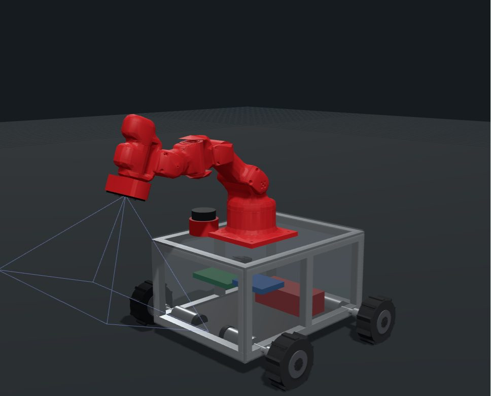

  

  

 

Brazo con las piezas CAD reales y chasis manejable. <a href="https://flkochu.github.io/proton/">Abrir la simulación</a> · <a href="https://github.com/flkochu/proton-brazo-6gdl">URDF y código</a>

  

 

También: SQL · ESP32 · ESP-IDF · FreeRTOS · micro-ROS · MoveIt2 · slam_toolbox · Fusion 360 · MQTT · YOLO · scikit-learn

  

 

  

 

Los 12 proyectos, con lo que hice en cada uno: <a href="https://flkochu.github.io/">flkochu.github.io</a> · <a href="https://github.com/flkochu/flkochu.github.io/tree/main/docs">documentación</a>

  

| Guía | Qué trae | |
|---|---|---|
| **Mecanismos y Actuadores** | Síntesis de cuatro barras con Freudenstein en MATLAB, calculadora interactiva y el caso del bote con pedal | [Abrir](https://flkochu.github.io/Guia-Mecanismos-y-Actuadores/) · [Repo](https://github.com/flkochu/Guia-Mecanismos-y-Actuadores) |
| **Procesamiento de Señales** | Filtros analógicos, DFT y transformada Z para los cuatro exámenes, con exámenes resueltos | [Abrir](https://flkochu.github.io/Guia-Procesamiento-de-Se-ales/) · [Repo](https://github.com/flkochu/Guia-Procesamiento-de-Se-ales) |
| **Selección de Materiales** | Ensayos mecánicos con 21 problemas resueltos y 49 preguntas de repaso | [Abrir](https://flkochu.github.io/Guia-Materiales-/) · [Repo](https://github.com/flkochu/Guia-Materiales-) |

 

<!-- LINKEDIN: cuando tengas la URL, quita los comentarios y pégala en href

-->

