


  


  

<a href="https://flkochu.github.io/proton/"></a>

<a href="https://flkochu.github.io/proton/">Abrir la simulación</a> · <a href="https://flkochu.github.io/#ALL-01">Ficha completa</a> · <a href="https://github.com/flkochu/proton-brazo-6gdl">URDF y código</a>

  

<a href="https://flkochu.github.io/#ALL-01"></a>
<a href="https://flkochu.github.io/atlas/"></a>
<a href="https://github.com/flkochu/ros2-slam-microros"></a>
<a href="https://github.com/flkochu/controlador-motores-esp32"></a>
<a href="https://flkochu.github.io/#ALL-02"></a>
<a href="https://flkochu.github.io/#ALL-06"></a>

Los 12 proyectos, con lo que hice en cada uno: <a href="https://flkochu.github.io/#proyectos">flkochu.github.io</a> · <a href="https://github.com/flkochu/flkochu.github.io/tree/main/docs">documentación</a>

  

<a href="https://flkochu.github.io/Guia-Mecanismos-y-Actuadores/"></a>
<a href="https://flkochu.github.io/Guia-Procesamiento-de-Se-ales/"></a>
<a href="https://flkochu.github.io/Guia-Materiales-/"></a>

Código de las guías: <a href="https://github.com/flkochu/Guia-Mecanismos-y-Actuadores">Mecanismos</a> · <a href="https://github.com/flkochu/Guia-Procesamiento-de-Se-ales">Señales</a> · <a href="https://github.com/flkochu/Guia-Materiales-">Materiales</a>

  

También: SQL · ESP32 · ESP-IDF · FreeRTOS · micro-ROS · MoveIt2 · slam_toolbox · Fusion 360 · MQTT · YOLO · scikit-learn

  

  

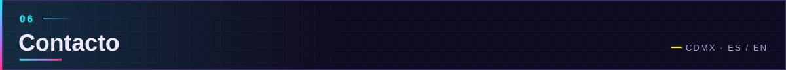

<a href="https://flkochu.github.io/#contacto">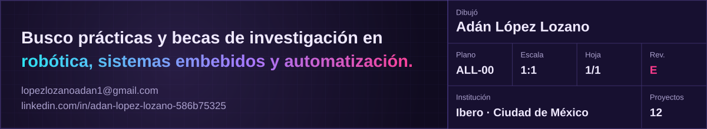</a>

  

